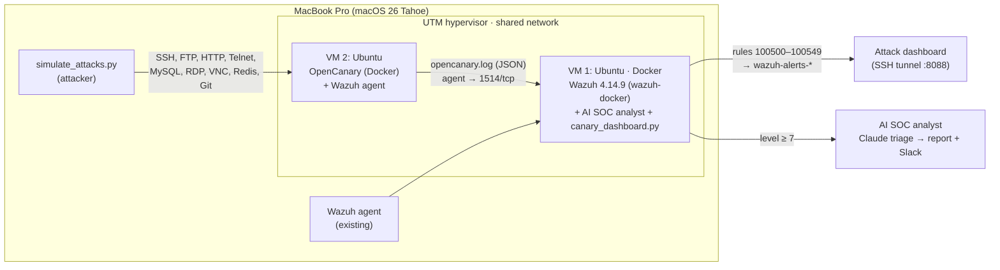
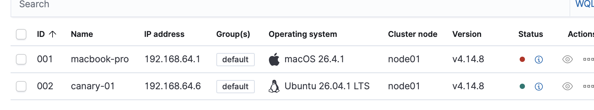
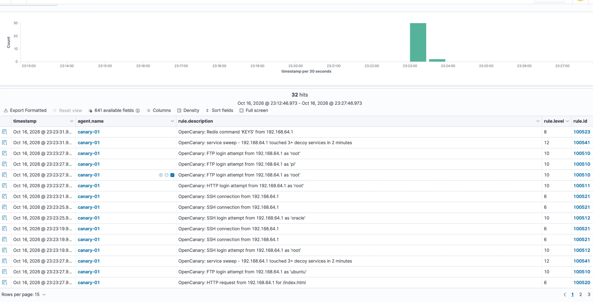
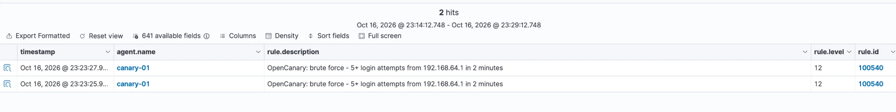
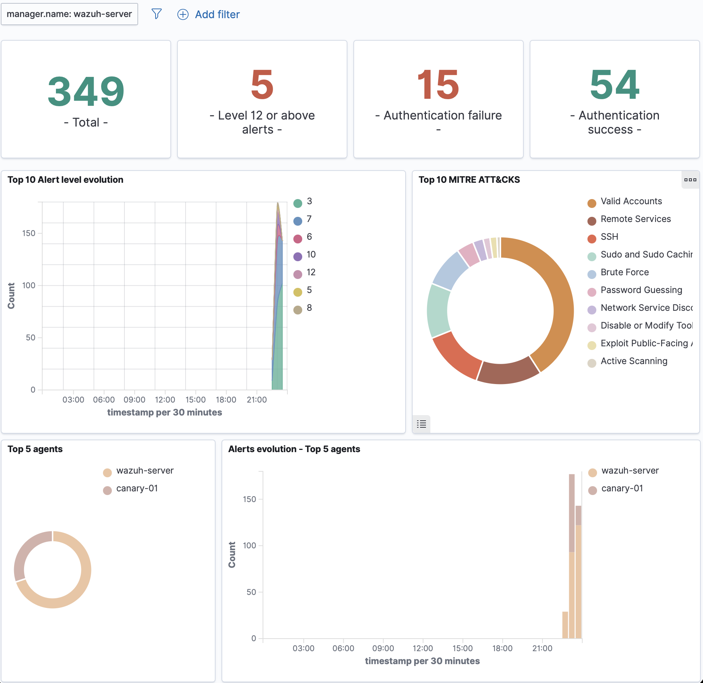
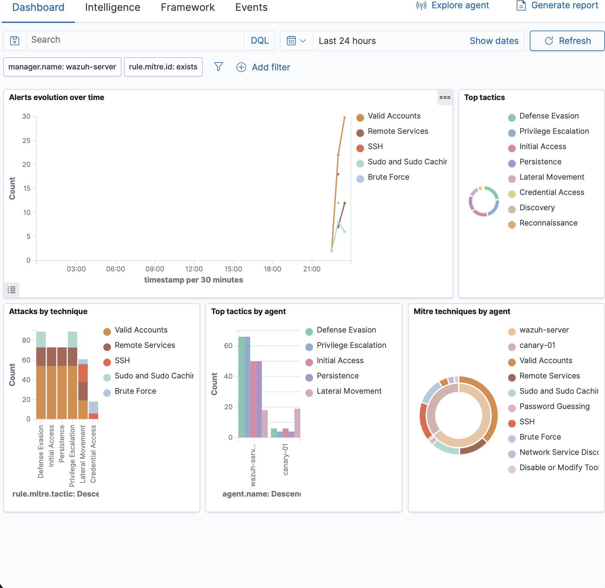
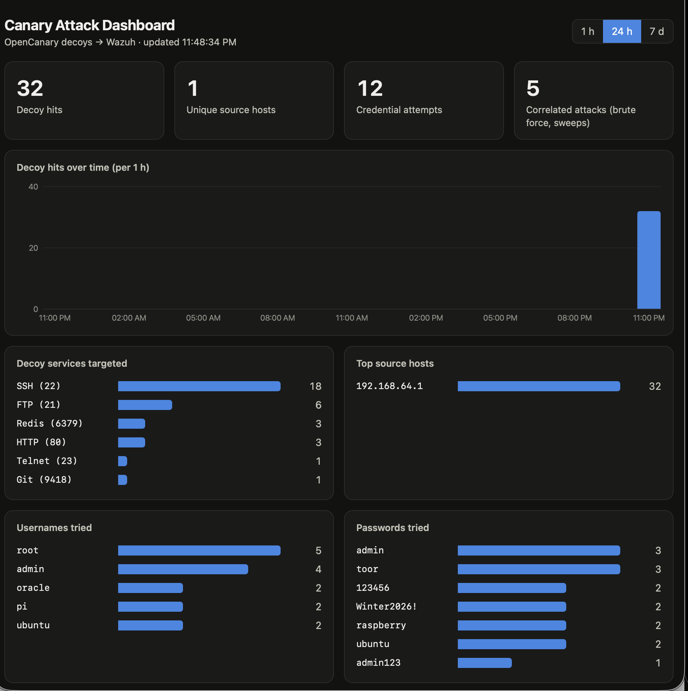
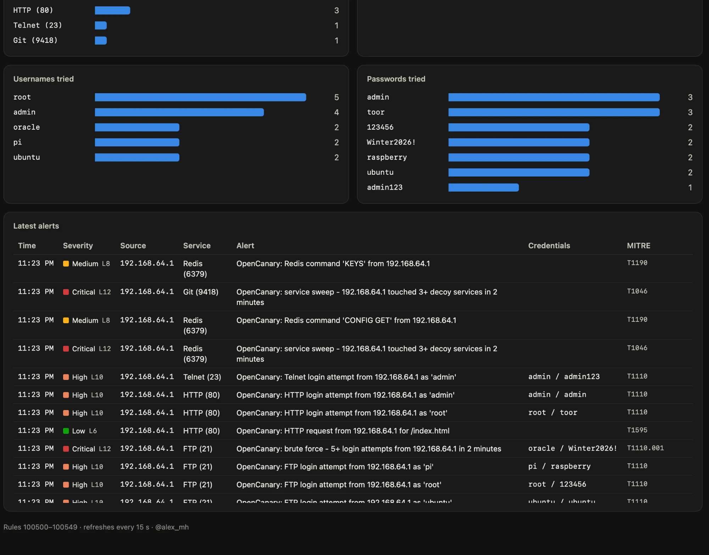
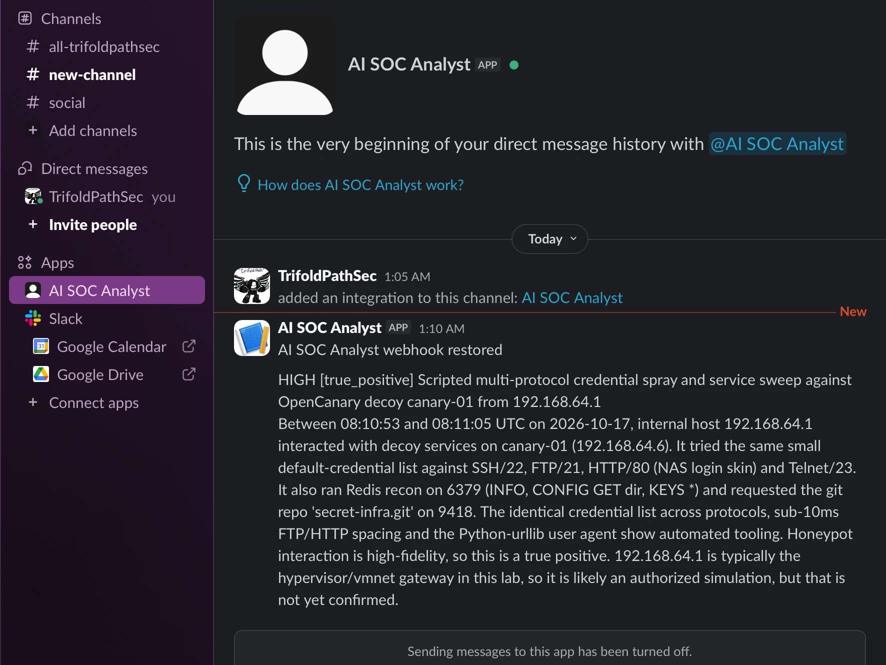

# blackout-honeypot-lab

**An internal honeypot that trips Wazuh alerts: OpenCanary decoys on a dedicated VM, custom detection rules with MITRE ATT&CK mapping, and a live attack dashboard.**

*By @alex_mh · TrifoldPathSec lab series, Project 4 · October 2026*

---

## Lab setup



### Why a separate VM for the honeypot

| Option | Verdict |
|---|---|
| **Dedicated canary VM** | ✅ Chosen. The decoys own real ports (22, 80, 3306...) on their own IP, a compromise of the honeypot is isolated from the SIEM, and Wazuh sees it as just another agent. |
| OpenCanary on the Wazuh VM | ❌ Port clashes (22 real SSH, 443 dashboard), and it puts attacker-facing services on the box that holds all your evidence. |
| OpenCanary on the Mac | ❌ Opens the ports the CIS hardening project just closed, and the firewall's stealth mode hides the decoys anyway. |

Sizing: OpenCanary is light. **1 vCPU, 1 GB RAM, 10 GB disk** is enough. Reuse the Ubuntu Server 26.04 arm64 ISO already used for the Wazuh VM.

## Build it

### 1. Create the canary VM (UTM)

1. New VM → Virtualize → Linux → Ubuntu Server 26.04 arm64 ISO.
2. 1 vCPU, 1024 MB RAM, 10 GB disk. Network: **Shared Network**, the same mode as the Wazuh VM, so the Mac and both VMs can reach each other.
3. Install with OpenSSH server enabled. Hostname: `canary-01`.
4. Note three IPs: canary VM (`ip -4 a`), Wazuh VM, and the Mac's address on the UTM bridge (`ifconfig bridge100` on the Mac).

### 2. Install OpenCanary and the Wazuh agent

Copy `canary-vm/` to the VM and run the setup script with the Wazuh VM's IP and the Mac's IP:

```bash
scp -r canary-vm <user>@<canary-ip>:~
```

```bash
ssh -t <user>@<canary-ip> 'cd canary-vm && sudo bash setup.sh <wazuh-ip> <mac-ip>'
```

The script:

- moves the real SSH to **port 2222**, reachable only from the Mac (UFW), so the decoy can take port 22;
- runs `thinkst/opencanary:0.9.10` in Docker on the host network with nine decoys: FTP 21, SSH 22, Telnet 23, HTTP 80 (NAS login page), MySQL 3306, RDP 3389, VNC 5900, Redis 6379, Git 9418;
- installs the Wazuh agent **4.14.8** (matching the manager), enrolls it as `canary-01`, and adds `/var/log/opencanary/opencanary.log` as a `json` log source;
- adds logrotate for the canary log.

From now on, manage the VM with `ssh -p 2222 <user>@<canary-ip>`.

### 3. Load the detection rules on the Wazuh server

The lab SIEM is the Dockerized Wazuh from the [AI SOC analyst lab](https://github.com/TrifoldPathSec/kshrike-ai-soc-analyst) (official `wazuh-docker` single-node), shared with [Sharrowkyn](https://github.com/TrifoldPathSec/sharrowkyn-phishing-analyzer). `install-docker.sh` mounts the rules into the manager container with a compose override, the same pattern Sharrowkyn uses:

```bash
scp -r wazuh-manager <user>@<wazuh-ip>:~
```

```bash
ssh -t <user>@<wazuh-ip> 'cd ~/wazuh-manager && sudo bash install-docker.sh'
```

The script adds `compose.opencanary.yml` to the project's `COMPOSE_FILE`, brings the stack up, runs `wazuh-analysisd -t` inside the manager and rolls `.env` back if validation fails. It also stops and disables any native (systemd) Wazuh on the VM so the two never compete for ports 1514, 1515, 443 and 9200. It takes the compose project folder as an argument (default `~/ai-soc-lab`).

On a native Wazuh install instead, copy the file to `/var/ossec/etc/rules/` (owner `wazuh:wazuh`, mode 0660) and restart `wazuh-manager`.

Test the rules before generating traffic. Open `wazuh-logtest` in the manager container and paste a line from `wazuh-manager/sample-events.jsonl`; the SSH sample should match rule **100512**, level 10, MITRE T1110:

```bash
ssh -t <user>@<wazuh-ip> 'cd ~/ai-soc-lab && sudo docker compose exec wazuh.manager /var/ossec/bin/wazuh-logtest'
```

### 4. Attack it

From the Mac:

```bash
python3 attack-sim/simulate_attacks.py <canary-ip>
```

Then in the Wazuh dashboard: **Threat Hunting** → filter `rule.groups: opencanary`. For a deeper run, use real tools from the Mac or a Kali VM: `nmap -sV <canary-ip>`, `hydra -l root -P rockyou.txt ssh://<canary-ip>`.

### 5. Open the attack dashboard

On the Wazuh VM (copy `dashboard/` over first; it needs only Python 3, no packages, no internet):

Copy the indexer's CA certificate next to the dashboard once. For wazuh-docker it is under the compose project; on a native install it is `/etc/wazuh-indexer/certs/root-ca.pem` (root-only):

```bash
sudo install -m 0644 ~/ai-soc-lab/wazuh-docker/single-node/config/wazuh_indexer_ssl_certs/root-ca.pem ~/dashboard/root-ca.pem
```

```bash
INDEXER_PASS='<indexer admin password>' python3 ~/dashboard/canary_dashboard.py --ca ~/dashboard/root-ca.pem
```

On the Mac, tunnel to it and open http://127.0.0.1:8088:

```bash
ssh -L 8088:127.0.0.1:8088 <user>@<wazuh-ip>
```

Preview it anywhere with generated data: `python3 dashboard/canary_dashboard.py --demo`.

Use the indexer admin password of your Wazuh deployment. A read-only indexer user is better than `admin`; set it with `INDEXER_USER`.

## Detection rules

`wazuh-manager/opencanary_rules.xml`. OpenCanary writes one JSON object per line, so Wazuh's built-in JSON decoder handles it with no custom decoder. Every rule keys off `node_id` starting with `canary-` and the numeric `logtype` from OpenCanary's `logger.py`.

| Rule | Level | Trigger | MITRE ATT&CK |
|---|---|---|---|
| 100501 | 3 | Honeypot started (logtype 1000) | — |
| 100510 | 10 | FTP login attempt (2000) | T1110 |
| 100511 | 10 | HTTP login POST (3001) | T1110 |
| 100512 | 10 | SSH login attempt (4002) | T1110, T1021.004 |
| 100513 | 10 | Telnet login attempt (6001) | T1110 |
| 100514 | 10 | MySQL login attempt (8001) | T1110 |
| 100515 | 10 | VNC authentication attempt (12001) | T1110, T1021.005 |
| 100520 | 6 | HTTP request (3000) | T1595 |
| 100521 | 6 | SSH connection / version exchange (4000, 4001) | T1021.004 |
| 100522 | 8 | RDP connection (14001) | T1021.001 |
| 100523 | 8 | Redis command (17001) | T1190 |
| 100524 | 8 | Git clone request (16001) | T1213 |
| 100529 | 6 | Any other decoy activity | — |
| **100540** | **12** | **Brute force:** 5+ login attempts from one source in 2 min | T1110.001 |
| **100541** | **12** | **Service sweep:** one source touches 3+ decoy ports in 2 min | T1046 |

Why the levels are high: nothing legitimate ever talks to a canary. One touch is already a lead, unlike a real SSH server where failed logins are noise.

## Dashboard

`dashboard/canary_dashboard.py` + `index.html`: a single-file Python server that queries `wazuh-alerts-*` on the indexer and serves:

- KPIs: decoy hits, unique source hosts, credential attempts, correlated attacks
- hits over time (1 h / 24 h / 7 d)
- decoy services targeted and top source hosts
- usernames and passwords attackers tried
- latest alerts with severity, credentials and MITRE technique

Binds to `127.0.0.1` by default, so it is only reachable through the SSH tunnel. It refreshes every 15 seconds.

## Results

First live run, 16 October 2026: `simulate_attacks.py` from the Mac (192.168.64.1) against canary-01 (192.168.64.6).

| Check | Result |
|---|---|
| canary-01 enrolled in Wazuh 4.14.8 | ✅ Active |
| Alerts in Threat Hunting (`rule.groups: opencanary`) | ✅ 32 alerts within seconds of the run |
| Per-service rules | ✅ SSH (100512, 100521), FTP (100510), HTTP (100511, 100520), Redis (100523) |
| Brute-force correlation (100540, level 12) | ✅ Fired twice (SSH and FTP rounds) |
| Service-sweep correlation (100541, level 12) | ✅ Fired |
| Attacker attribution | ✅ Every alert names 192.168.64.1, with the usernames and passwords tried |
| Attack dashboard (24 h) | ✅ 32 decoy hits · 1 source host · 12 credential attempts · 5 correlated attacks. Services: SSH 18, FTP 6, Redis 3, HTTP 3, Telnet 1, Git 1 |

**canary-01 enrolled next to the macOS endpoint**



**Threat Hunting: 32 OpenCanary alerts from one run, including the service-sweep correlation**



**Brute-force correlation (rule 100540, level 12)**



**Wazuh overview and MITRE ATT&CK views after the run.** The honeypot adds Brute Force, Password Guessing, Network Service Discovery, Exploit Public-Facing Application and Active Scanning to the technique mix.





**Canary Attack Dashboard**





### Triaged by the AI SOC analyst

On the shared Docker Wazuh, the [AI SOC analyst](https://github.com/TrifoldPathSec/kshrike-ai-soc-analyst) polls for alerts at level 7 or higher. After one `simulate_attacks.py` run it grouped 39 new alerts into two cases and had Claude triage them:

```
39 new alert(s) -> 2 case(s)
triaging case canary-01-opencanary-n_a (19 alerts, level 12)
  -> high / true_positive   report: 20261017T073945Z_high_canary-01-opencanary-n_a.md
triaging case canary-01-ossec-n_a (20 alerts, level 7)
  -> low / false_positive   report: 20261017T074003Z_low_canary-01-ossec-n_a.md
```

The report titled the honeypot case *"Scripted multi-protocol credential spraying and service sweep against OpenCanary decoy canary-01"* (confidence 0.88). It mapped it to T1046, T1110.001, T1078.001, T1021.004, T1190 and T1213.003 and read the evidence closely: FTP attempts 14 ms apart as proof of scripting, `CONFIG GET dir` as Redis recon that usually comes before a webshell or `authorized_keys` write, and 192.168.64.1 as the likely hypervisor host, so probably a simulated attack. The second case, the canary's own agent re-enrollment noise, was correctly dismissed as a false positive.

The report also noticed that the case had no source IP: the analyst read `srcip`, while OpenCanary reports `src_host`. The fix is a one-line fallback to `src_host` in the analyst's `correlate.py`, so honeypot cases are grouped per attacker and get IP enrichment.

High and critical cases are posted to Slack. After the fix, the next run arrived as a case attributed to 192.168.64.1, with the full triage summary:



## Lessons learned

- **Check what already owns the ports.** The Wazuh manager would not start: `wazuh-authd` failed with `Unable to Bind port '1515'`. A Docker Wazuh stack from an earlier lab (`ai-soc-lab`) was starting at boot and holding 1514, 1515, 443 and 9200. `ss -ltnp` showed `docker-proxy` as the owner. The first fix stopped those containers, which also silently took down the AI SOC analyst and Sharrowkyn that depend on them. The final fix went the other way: keep the shared Docker Wazuh, disable the native install, and load the honeypot rules into the container (`install-docker.sh`). **Before switching anything off, find out what depends on it.**
- **Two SIEMs means two sets of credentials.** The dashboard rejected the saved admin password because it belonged to the Docker stack. Testing it against the indexer directly (`curl -u admin:… https://127.0.0.1:9200` → `401`) separated "wrong password" from "service down".
- **Changing the admin password has a second step.** Filebeat ships alerts to the indexer with the admin password. After `wazuh-passwords-tool.sh`, the Filebeat keystore must be updated too, or alerts stop reaching the dashboard without any visible error.
- **Newer Python is stricter about certificates.** Python 3.13+ rejects Wazuh's self-generated root CA ("CA cert does not include key usage extension"). The dashboard clears only that strict flag and still verifies the chain against the Wazuh CA, rather than turning verification off.
- **Validate rules before restarting.** `wazuh-analysisd -t` returned 0, which ruled out the new rules file as the cause of the outage.
- **An agent can only belong to one manager.** Moving canary-01 to the Docker manager failed with `Duplicate agent name: canary-01`: it had first enrolled there, and the old entry still held the name. `manage_agents -r <id>` in the manager container cleared it, and the agent re-enrolled on its next retry.
- **Decoys move the real services.** After setup, port 22 on the canary is the honeypot, and administration happens on 2222, restricted to the Mac.

## Repository layout

```
canary-vm/
  setup.sh                 builds the canary VM end to end
  opencanary.conf          decoy services and JSON file logging
  docker-compose.yml       OpenCanary 0.9.10, host network
wazuh-manager/
  opencanary_rules.xml     rules 100500-100549
  sample-events.jsonl      real-format events for wazuh-logtest
  install-docker.sh        loads the rules into a wazuh-docker manager
  compose.opencanary.yml   compose override that mounts the rules
dashboard/
  canary_dashboard.py      indexer query + web server (stdlib only)
  index.html               the dashboard page
attack-sim/
  simulate_attacks.py      safe traffic generator for your own canary
```

## Safety

- **Do not port-forward the canary to the internet** from a home router. This lab is an *internal* tripwire: it detects movement inside your network. An internet-facing honeypot needs its own isolated network segment.
- Run `simulate_attacks.py` only against your own canary VM.
- The canary's real SSH is limited to the Mac's IP. If that IP changes, update UFW from the UTM console: `sudo ufw allow from <new-ip> to any port 2222 proto tcp`.

## Next steps

- [ ] Wazuh active response: block the source on other agents when 100540 fires (needs `srcip`; add a decoder that maps `src_host`)
- [ ] Enable the OpenCanary port-scan module (iptables logging) for SYN / NMAP OS-fingerprint detection
- [ ] Add an SMB file-share decoy with Samba audit logging
- [ ] Import the dashboard into the Wazuh dashboard as saved objects
- [ ] Integrate alerts at level 12 with Slack or email

---

*Part of the TrifoldPathSec lab series. Lab-only.*
